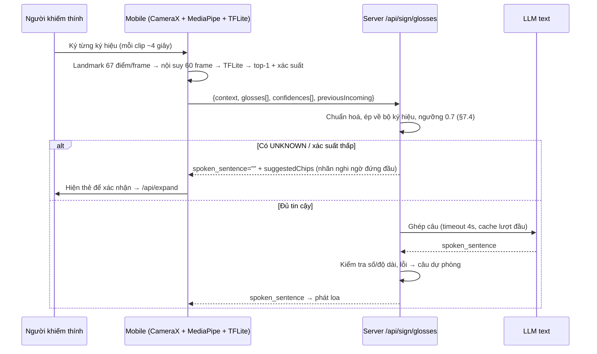

# Guideline — Nhận diện ký hiệu Hybrid (offline trên mobile + ghép câu ở server)

> Hợp đồng API: `docs/luong-xu-ly-chinh.md` §4.2a. File này hướng dẫn **tải model, convert, đặt file** và **yêu cầu tiền xử lý** phía mobile.
> Nội dung đánh dấu **[cần xác nhận]** chưa được kiểm chứng trên thiết bị thật.

## 1. Luồng



So với `/api/sign` (gửi 4–16 ảnh JPEG cho LLM vision): request chỉ vài trăm byte, không gửi ảnh người dùng lên server, phần nhận diện chạy được khi mất mạng; khi có mạng chỉ còn 1 lời gọi LLM text (hoặc 0 khi trúng cache / confidence thấp).

## 2. Nguồn model

| Mục | Giá trị |
|---|---|
| Repo | `https://github.com/photienanh/Vietnamese-Sign-Language-Recognition` (commit `982715e`, 2025-06-28) |
| Model | `Models/checkpoints/final_model.keras` — 62.492.500 byte, sha256 `6cd6f668…628624817`, Keras 3.5.0, 3 × BiLSTM(256) + Dense, softmax 2.764 lớp |
| Nhãn | `Logs/label_map.json` — `{"nhãn": index}`, 2.764 nhãn, index 0..2763 liền mạch |
| Dữ liệu train | Video từ điển `qipedc.moet.gov.vn` (theo `download_data.py`) |
| License | Repo **không có file LICENSE** → **[cần xác nhận]** quyền dùng/phân phối model trong APK trước khi phát hành. Vì vậy model/nhãn **không commit** vào repo này (`.gitignore`: `data/vsl/`, `*.tflite`, `*.keras`) |

**Bộ từ vựng:** là từ điển VSL phổ thông (địa danh, toán, đời sống…), **không** trùng bộ ký hiệu demo §7. Trong 20 gloss §7.1 chỉ `SỐT`, `BỤNG`, `GIẤY TỜ`, `BAO NHIÊU` có nhãn trùng y hệt; nhiều gloss khác chỉ có nhãn gần nghĩa (`chào`, `đau bụng`, `hiệu thuốc`, `trà đá`, `đồ uống`…) hoặc không có (`CẢM ƠN`, `THANH TOÁN`, `Ở ĐÂU`, `MANG ĐI`). Server chấp nhận cả hai bộ (§7.2 ∪ nhãn model). Muốn phủ ngữ cảnh quầy dịch vụ → cần thu thêm dữ liệu và train lại **[cần xác nhận]**.

## 3. Tải model về local

```powershell
# Ngoài repo SignBridge-AI (hoặc trong repo — thư mục đã nằm trong .gitignore)
git clone --depth 1 https://github.com/photienanh/Vietnamese-Sign-Language-Recognition
```

Không cần chạy `main.py`/`download_data.py` của repo đó (Streamlit, Selenium, chromedriver — chỉ phục vụ train lại).

## 4. Convert sang TFLite

Dùng venv **riêng** để TensorFlow không lọt vào server:

```powershell
python -m venv venv-vsl
./venv-vsl/Scripts/python.exe -m pip install -r tools/requirements-vsl.txt
./venv-vsl/Scripts/python.exe tools/convert_vsl_tflite.py `
    --model  ../Vietnamese-Sign-Language-Recognition/Models/checkpoints/final_model.keras `
    --labels ../Vietnamese-Sign-Language-Recognition/Logs/label_map.json `
    --out-dir data/vsl --quant dynamic
```

| Tuỳ chọn `--quant` | Khi nào |
|---|---|
| `dynamic` (mặc định) | Trọng số int8 — 5,5 MB, phù hợp APK |
| `none` | Float32 — 20,9 MB, khớp Keras tuyệt đối; dùng để đối chiếu |

Không hỗ trợ `float16`: đã thử, lệch Keras **nhiều hơn** int8 (xem §8).

Output trong `data/vsl/`:

| File | Ai dùng | Nội dung |
|---|---|---|
| `vsl_model.tflite` | Mobile (`assets/`) | Input `[1, 60, 201]` float32 → output `[1, 2764]` softmax |
| `labels.json` | Mobile + **server** | List nhãn theo index: `labels[i]` ↔ `output[i]` |
| `vsl_model.json` | Người review | sha256, kích thước, so khớp Keras ↔ TFLite, độ trễ CPU desktop |
| `vsl_golden.json` | Test unit mobile | Input mẫu + top-5 kỳ vọng — nạp vào TFLite trên Android, top-5 phải trùng |

Kết quả convert thật: xem §8.

## 5. Cấu hình server

```dotenv
VSL_LABELS_PATH=data/vsl/labels.json     # không có file → chỉ chấp nhận bộ ký hiệu §7
VSL_MIN_GLOSS_CONFIDENCE=0.7             # xác suất từng ký hiệu
SIGN_CONFIDENCE_THRESHOLD=0.7            # ngưỡng chung (đã có)
AI_TIMEOUT_GLOSSES=4
```

Kiểm tra: `GET /api/health` → `"vsl_labels": 2764`. Nếu là `0` → server không thấy file, mọi nhãn ngoài §7 sẽ thành `UNKNOWN`.

Server **không** cần TensorFlow, không chạy model.

## 6. Yêu cầu tiền xử lý phía mobile (phải khớp lúc train)

Lấy từ `main.py` của repo nguồn. Lệch bất kỳ bước nào → độ chính xác giảm mà không báo lỗi.

| Bước | Yêu cầu |
|---|---|
| Landmark | MediaPipe **Holistic**: 25 điểm pose đầu tiên (index 0–24), 21 điểm tay trái, 21 điểm tay phải. Mỗi điểm `(x, y, z)` toạ độ chuẩn hoá theo ảnh (không dùng world landmarks) |
| Thứ tự vector 201 | `[pose0.x, pose0.y, pose0.z, …, pose24.z, left0.x, …, left20.z, right0.x, …, right20.z]` |
| Thiếu bộ phận | Không thấy tay/pose → điền 0 cho cả khối đó |
| Ảnh vào MediaPipe | RGB, **không** lật gương (repo nguồn đưa thẳng frame webcam vào MediaPipe) **[cần xác nhận]** với camera trước Android |
| Độ dài clip | Repo nguồn ghi 4 giây sau 1,5 giây chuẩn bị, lấy mọi frame đọc được |
| Nội suy | Cubic theo thời gian (scipy `interp1d(kind="cubic", fill_value="extrapolate")`) về **60 frame**. Trên Kotlin dùng cubic spline; nội suy tuyến tính là xấp xỉ **[cần xác nhận]** độ lệch |
| Suy luận | `interpreter.run(input[1][60][201], output[1][2764])` → `argmax` = nhãn, `max` = confidence |

**Lưu ý MediaPipe trên Android [cần xác nhận]:** Holistic "legacy solution" (Python `mp.solutions.holistic`) khác MediaPipe Tasks. Nếu dùng `PoseLandmarker` + `HandLandmarker` thay thế: (1) quy ước tay trái/phải của `HandLandmarker` theo ảnh, Holistic theo người → có thể phải đổi chỗ khối tay; (2) toạ độ có thể lệch nhẹ so với Holistic. Kiểm bằng cách quay cùng một video, so vector landmark với Python.

## 7. Mobile gọi server

```http
POST /api/sign/glosses
Content-Type: application/json

{"context":"PHARMACY","glosses":["đau bụng","hiệu thuốc"],"confidences":[0.93,0.81],"previousIncoming":null}
```

- Gửi nhãn **nguyên văn** từ `labels.json`; server tự chuẩn hoá.
- 1 clip = 1 ký hiệu. Gom các clip của một lượt (tối đa 10) rồi gọi 1 lần.
- `spoken_sentence` rỗng → hiện `glosses` + `suggestedChips` (nhãn nghi ngờ đứng đầu) cho người dùng xác nhận → `/api/expand`.
- Mất mạng → mobile tự ghép nhãn thành câu đơn giản (giống câu dự phòng của server: `"Đau bụng, hiệu thuốc."`) để phát loa.

## 9. Code mẫu tích hợp Android (Kotlin Reference)

Dành cho bạn dev Mobile tích hợp vào ứng dụng Android.

### 9.1. Cấu hình `build.gradle.kts` (app)

```kotlin
dependencies {
    // TensorFlow Lite Runtime (chỉ 1MB thư viện, không cần Flex Delegate)
    implementation("org.tensorflow:tensorflow-lite:2.14.0")
    
    // Retrofit / OkHttp gọi API Server
    implementation("com.squareup.retrofit2:retrofit:2.9.0")
    implementation("com.squareup.retrofit2:converter-gson:2.9.0")
}

android {
    // Không nén file tflite khi build APK
    aaptOptions {
        noCompress("tflite")
    }
}
```

### 9.2. Đặt file vào Android Project

Copy 2 file sinh bởi `tools/convert_vsl_tflite.py` vào thư mục assets của app:
* `app/src/main/assets/vsl_model.tflite` (5,5 MB)
* `app/src/main/assets/labels.json` (2.764 nhãn)

### 9.3. Class Kotlin chạy Model (`VslClassifier.kt`)

```kotlin
package com.signbridge.ai.vsl

import android.content.Context
import org.json.JSONArray
import org.tensorflow.lite.Interpreter
import java.io.FileInputStream
import java.nio.ByteBuffer
import java.nio.ByteOrder
import java.nio.channels.FileChannel

class VslClassifier(private val context: Context) {
    private var interpreter: Interpreter? = null
    private val labels = mutableListOf<String>()

    init {
        // 1. Nạp Model TFLite
        val assetFd = context.assets.openFd("vsl_model.tflite")
        val inputStream = FileInputStream(assetFd.fileDescriptor)
        val fileChannel = inputStream.channel
        val modelByteBuffer = fileChannel.map(
            FileChannel.MapMode.READ_ONLY, 
            assetFd.startOffset, 
            assetFd.declaredLength
        )
        val options = Interpreter.Options().apply {
            setNumThreads(4) // Sử dụng 4 luồng CPU cho hiệu năng tối ưu
        }
        interpreter = Interpreter(modelByteBuffer, options)

        // 2. Nạp Danh sách Nhãn labels.json
        val jsonString = context.assets.open("labels.json").bufferedReader().use { it.readText() }
        val jsonArray = JSONArray(jsonString)
        for (i in 0 until jsonArray.length()) {
            labels.add(jsonArray.getString(i))
        }
    }

    /**
     * Chạy nhận diện cho 1 clip cử chỉ:
     * @param inputBuffer Mảng float 60 frames x 201 điểm [1, 60, 201]
     * @return Pair(nhãn top-1, xác suất confidence 0.0 -> 1.0)
     */
    fun classifySign(inputBuffer: Array<Array<FloatArray>>): Pair<String, Float> {
        val output = Array(1) { FloatArray(labels.size) } // Shape [1, 2764]
        interpreter?.run(inputBuffer, output)

        val probabilities = output[0]
        var maxIdx = 0
        var maxProb = 0f
        for (i in probabilities.indices) {
            if (probabilities[i] > maxProb) {
                maxProb = probabilities[i]
                maxIdx = i
            }
        }
        val label = if (maxIdx in labels.indices) labels[maxIdx] else "UNKNOWN"
        return Pair(label, maxProb)
    }

    fun close() {
        interpreter?.close()
        interpreter = null
    }
}
```

### 9.4. Gọi API Server ghép câu (`SignApiService.kt`)

```kotlin
data class SignGlossesRequest(
    val context: String,                       // "CAFE", "PHARMACY", "PUBLIC", "CUSTOM"
    val glosses: List<String>,                 // Danh sách nhãn: ["đau bụng", "hiệu thuốc"]
    val confidences: List<Float>,              // Xác suất: [0.93, 0.81]
    val previousIncoming: String? = null       // Câu nhân viên vừa nói (nếu có)
)

data class SignResponse(
    val glosses: List<String>,
    val confidence: Float,
    val spoken_sentence: String,               // Câu hoàn chỉnh -> Gửi loa TTS phát âm
    val suggestedChips: List<String>           // Thẻ gợi ý nếu cần xác nhận
)

interface SignApiService {
    @POST("/api/sign/glosses")
    suspend fun sendGlosses(@Body req: SignGlossesRequest): Response<SignResponse>
}
```

### 9.5. Luồng xử lý giao diện phía Mobile

```kotlin
// Khi người khiếm thính quay xong 1 hoặc nhiều cử chỉ:
val resultList = mutableListOf<Pair<String, Float>>()
resultList.add(classifier.classifySign(clip1Landmarks)) // VD: Pair("đau bụng", 0.92f)
resultList.add(classifier.classifySign(clip2Landmarks)) // VD: Pair("hiệu thuốc", 0.85f)

// Gửi lên server
val request = SignGlossesRequest(
    context = currentContext,
    glosses = resultList.map { it.first },
    confidences = resultList.map { it.second },
    previousIncoming = lastStaffSpeech
)

val response = apiService.sendGlosses(request).body()

if (response != null) {
    if (response.spoken_sentence.isNotBlank()) {
        // 1. Đủ tin cậy -> Phát loa TTS tiếng Việt ngay lập tức
        textToSpeech.speak(response.spoken_sentence, TextToSpeech.QUEUE_FLUSH, null, "tts_1")
    } else {
        // 2. Độ tin cậy thấp hoặc có UNKNOWN -> Hiện thẻ gợi ý cho người dùng chạm chọn
        showSuggestedChipsDialog(response.suggestedChips)
    }
}
```

**Convert** — TensorFlow 2.18.1 + Keras 3.15.1, chỉ op builtin (không cần Flex / `select-tf-ops`). LSTM thành vòng `WHILE`, không phải op LSTM gộp sẵn.

| `--quant` | Kích thước | Top-1 trùng Keras (512 mẫu) | Top-1 trùng khi Keras ≥ 0,7 | Cùng quyết định chấp nhận | Độ trễ CPU desktop (mean / p95) |
|---|---|---|---|---|---|
| `none` | 20,9 MB | 100% (128 mẫu, lệch xác suất ≤ 6e-6) | 100% | — | — |
| **`dynamic`** | **5,5 MB** | 95,5% | **100%** (273/273) | 89,7% | **8,0 / 10,3 ms** |
| `float16` (đã bỏ) | 10,5 MB | 66,8% | 83,8% | 52,7% | 37,4 / 43,6 ms |

- Input so khớp là **chuỗi landmark tổng hợp**, không phải video thật → chỉ chứng minh convert đúng, **không** đo độ chính xác nhận diện. Độ chính xác thật trên người dùng: **[cần xác nhận]** bằng video quay trên điện thoại.
- "Cùng quyết định chấp nhận" = cùng nhãn **và** cùng phía ngưỡng 0,7. ~10% lệch là mẫu sát ngưỡng → server đưa về luồng xác nhận bằng thẻ, không phát loa sai.
- Độ trễ đo trên CPU desktop; trên điện thoại **[cần xác nhận]**.

**Server `/api/sign/glosses`** — uvicorn local, `labels.json` 2.764 nhãn, LLM `gemini-flash-lite-latest` qua `LLM_BASE_URL`. Thời gian xử lý theo log server:

| Trường hợp | Server xử lý | Kết quả |
|---|---|---|
| `["đau bụng","hiệu thuốc"]`, lượt đầu | 1.753 ms | "Chào bạn, mình bị đau bụng và đang tìm hiệu thuốc ạ." |
| Cùng request, lần 2 (cache) | 1 ms | Cùng câu |
| Có `previousIncoming` (không cache) | 1.020 ms | "Dạ, mình bị đau bụng, muốn tìm hiệu thuốc ạ." |
| 1 ký hiệu xác suất 0,42 | 1 ms (không gọi LLM) | `spoken_sentence=""`, thẻ `hiệu thuốc` đứng đầu |
| Nhãn ngoài bộ (`pizza`) | 1 ms | `UNKNOWN`, `spoken_sentence=""` |
| `CAFE`: `["trà đá","bao nhiêu"]` | 1.140 ms | "Cho mình hỏi trà đá giá bao nhiêu ạ?" |
| `glosses=[]` | 1 ms | 422 `NO_SIGN_DETECTED` |

Tổng thời gian ước tính cho một lượt ≈ suy luận trên máy (~10 ms/clip desktop) + 1–1,8 giây LLM, hoặc ~0 khi trúng cache / cần xác nhận. So với `/api/sign` (LLM vision, timeout 6 giây) chưa đo cùng điều kiện **[cần xác nhận]**.
