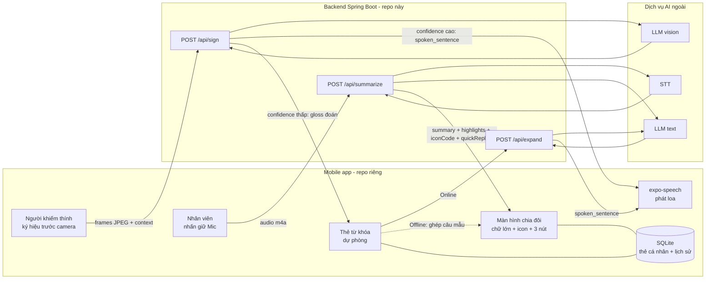
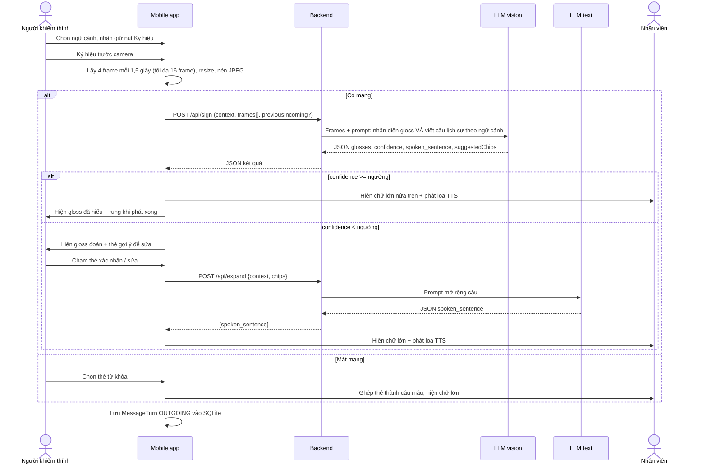
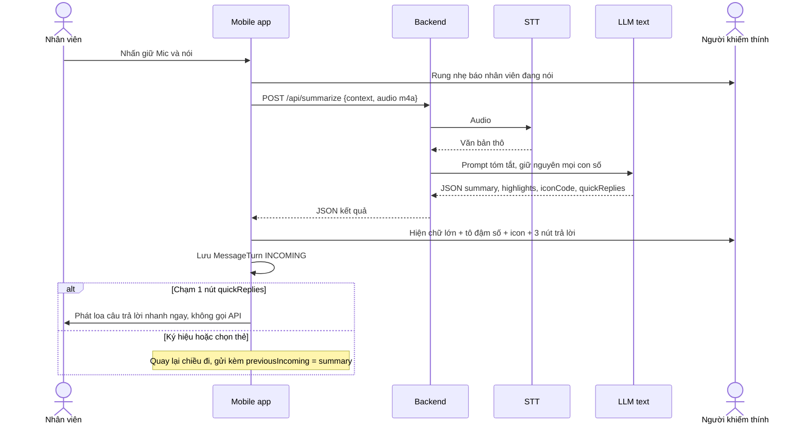

# Luồng xử lý chính — SignBridge

> Nguồn: `Mo_ta_y_tuong.docx` §5, §6, §7, §10, §13 + quyết định của team:
> - Người khiếm thính dùng **ngôn ngữ ký hiệu** làm đầu vào chính.
> - Nhận diện ký hiệu: mobile gửi **khung hình** lên backend, backend gọi **LLM đa phương thức (vision)**.
> - Thẻ từ khóa giữ làm **dự phòng** khi nhận diện kém hoặc mất mạng.
>
> Tên endpoint, field JSON, số frame, ngưỡng `confidence` là **đề xuất**, chưa có trong code. Cần chốt với team mobile.

## 1. Tổng quan



## 2. Chiều đi — ngôn ngữ ký hiệu → câu nói



## 3. Chiều về — giọng nói nhân viên → tóm tắt



## 4. Đặc tả API (đề xuất)

> Toàn bộ mục này là **đề xuất**, chưa có trong code. Giới hạn kích thước, enum, ngưỡng là số khởi điểm — chốt với team mobile.

### 4.0. Quy ước chung

| Mục | Giá trị |
|---|---|
| Base path | `/api` |
| Encoding | UTF-8, response luôn `application/json` |
| Xác thực | Không có (prototype hackathon) |
| Trạng thái | Backend **stateless**: không lưu frame, audio, lịch sử. Lịch sử nằm ở SQLite trên mobile |
| Timeout phía mobile | 10 giây/request. Quá hạn → chuyển chế độ dự phòng (thẻ / câu mẫu) |

**Enum `context`** (theo docx §11 `ContextPreset.name`):

| Giá trị | Ý nghĩa |
|---|---|
| `CAFE` | Quán ăn / cà phê |
| `PHARMACY` | Hiệu thuốc / bệnh viện |
| `PUBLIC` | Hành chính công |
| `CUSTOM` | Tự do / không rõ bối cảnh |

**Response lỗi chung** (mọi endpoint):

```json
{
  "error": {
    "code": "AI_TIMEOUT",
    "message": "Dịch vụ AI phản hồi quá chậm, vui lòng thử lại."
  }
}
```

| HTTP | `error.code` | Khi nào | Mobile xử lý |
|---|---|---|---|
| 400 | `INVALID_REQUEST` | Thiếu field, sai enum, sai số lượng | Báo lỗi, không retry |
| 413 | `PAYLOAD_TOO_LARGE` | Vượt giới hạn file | Nén lại rồi gửi lại |
| 415 | `UNSUPPORTED_MEDIA_TYPE` | Sai định dạng ảnh/audio | Báo lỗi |
| 422 | `NO_SIGN_DETECTED` | `/sign`: không thấy tay/ký hiệu | Hiện thẻ dự phòng |
| 422 | `NO_SPEECH_DETECTED` | `/summarize`: audio im lặng/không nghe rõ | Nhắc nhân viên nói lại |
| 502 | `AI_UPSTREAM_ERROR` | Dịch vụ AI lỗi hoặc trả JSON sai schema | Chuyển chế độ dự phòng |
| 504 | `AI_TIMEOUT` | Dịch vụ AI quá hạn | Chuyển chế độ dự phòng |

---

### 4.1. `GET /api/health`

Mobile gọi khi mở app / trước mỗi lượt để biết có dùng được AI không.

**Response 200**

```json
{ "status": "UP" }
```

---

### 4.2. `POST /api/sign` — ký hiệu → câu nói

**Request:** `Content-Type: multipart/form-data`

| Field | Kiểu | Bắt buộc | Ràng buộc | Mô tả |
|---|---|---|---|---|
| `context` | text | có | enum `context` | Bối cảnh điểm dịch vụ |
| `frames` | file (lặp lại) | có | 4–16 file, số lượng là bội của 4 (4 frame mỗi 1,5 giây, clip tối đa 6 giây), `image/jpeg`, mỗi file ≤ 250 KB, cạnh dài ≤ 640 px | Khung hình theo đúng thứ tự thời gian |
| `personalChips` | text (JSON array) | không | ≤ 20 phần tử | Thẻ cá nhân của người dùng (tên, dị ứng…) để LLM tham khảo |
| `previousIncoming` | text | không | ≤ 300 ký tự | `summary` lượt nhân viên vừa nói. Lượt đầu để trống; từ lượt 2 gửi kèm để câu trả lời đúng mạch |

**Ví dụ request**

```bash
curl -X POST http://localhost:8080/api/sign \
  -F context=PHARMACY \
  -F frames=@f1.jpg -F frames=@f2.jpg -F frames=@f3.jpg -F frames=@f4.jpg \
  -F 'personalChips=["Dị ứng penicillin"]' \
  -F 'previousIncoming=Bạn đau đầu lâu chưa?'
```

**Response 200**

| Field | Kiểu | Mô tả |
|---|---|---|
| `glosses` | string[] | Các từ ký hiệu nhận ra, đúng thứ tự ký hiệu. **Chỉ gồm từ trong bộ ký hiệu (mục 7) hoặc `UNKNOWN`** |
| `confidence` | number 0–1 | Độ tin cậy do LLM tự đánh giá |
| `spoken_sentence` | string | Câu tiếng Việt lịch sự để phát loa. Rỗng khi `confidence` < ngưỡng |
| `suggestedChips` | string[] | 3–6 thẻ gợi ý để người dùng sửa khi `confidence` thấp |

```json
{
  "glosses": ["ĐAU", "ĐẦU", "MUA", "THUỐC"],
  "confidence": 0.82,
  "spoken_sentence": "Chào bạn, mình bị đau đầu, muốn mua thuốc.",
  "suggestedChips": ["Đau đầu", "Mua thuốc", "Không buồn ngủ"]
}
```

Ngưỡng đề xuất: `confidence` ≥ 0.7 → mobile phát loa luôn; < 0.7 → hiện `glosses` + `suggestedChips` để người dùng xác nhận, rồi gọi `/api/expand`.

---

### 4.3. `POST /api/expand` — thẻ từ khóa → câu nói

**Request:** `Content-Type: application/json`

| Field | Kiểu | Bắt buộc | Ràng buộc | Mô tả |
|---|---|---|---|---|
| `context` | string | có | enum `context` | Bối cảnh |
| `chips` | string[] | có | 1–5 phần tử, mỗi phần tử ≤ 50 ký tự | Thẻ người dùng chọn, đúng thứ tự chạm |
| `previousIncoming` | string | không | ≤ 300 ký tự | `summary` lượt nhân viên vừa nói, để câu trả lời đúng mạch |

```json
{
  "context": "PHARMACY",
  "chips": ["Đau đầu", "Không buồn ngủ", "Uống sau ăn"],
  "previousIncoming": null
}
```

**Response 200**

| Field | Kiểu | Mô tả |
|---|---|---|
| `spoken_sentence` | string | Câu tiếng Việt lịch sự để phát loa, ≤ 40 từ |

```json
{
  "spoken_sentence": "Chào bạn, mình muốn mua thuốc giảm đau đầu loại không gây buồn ngủ, nhờ bạn tư vấn liều uống sau ăn giúp mình."
}
```

---

### 4.4. `POST /api/summarize` — giọng nhân viên → tóm tắt

**Request:** `Content-Type: multipart/form-data`

| Field | Kiểu | Bắt buộc | Ràng buộc | Mô tả |
|---|---|---|---|---|
| `context` | text | có | enum `context` | Bối cảnh |
| `audio` | file | có | `audio/m4a` hoặc `audio/mp4`, ≤ 60 giây, ≤ 2 MB | Ghi âm push-to-talk |
| `previousOutgoing` | text | không | ≤ 300 ký tự | `spoken_sentence` lượt trước của người khiếm thính, để tóm tắt và gợi ý đúng mạch |

```bash
curl -X POST http://localhost:8080/api/summarize \
  -F context=PHARMACY \
  -F audio=@nhan-vien.m4a \
  -F 'previousOutgoing=Chào bạn, mình bị đau đầu, muốn mua thuốc giảm đau.'
```

**Response 200**

| Field | Kiểu | Mô tả |
|---|---|---|
| `transcript` | string | Văn bản STT đầy đủ (để xem lại khi cần) |
| `summary` | string | Ý chính, ≤ 15 từ, giữ nguyên mọi con số |
| `highlights` | object[] | Thông tin cần tô đậm |
| `highlights[].type` | enum | `PRICE` · `COUNTER` · `DOSAGE` · `TIME` · `QUANTITY` · `OTHER` |
| `highlights[].text` | string | Chuỗi nguyên văn có trong `summary` |
| `iconCode` | enum | Icon minh hoạ, xem bảng dưới |
| `quickReplies` | string[] | Đúng 3 câu trả lời nhanh |

```json
{
  "transcript": "Dạ bạn dùng Panadol xanh nha, uống một viên sau ăn, ngày hai lần, hộp này giá ba mươi lăm nghìn.",
  "summary": "Panadol Xanh • 1 viên sau ăn • Ngày 2 lần • 35.000đ",
  "highlights": [
    { "type": "DOSAGE", "text": "1 viên" },
    { "type": "QUANTITY", "text": "Ngày 2 lần" },
    { "type": "PRICE", "text": "35.000đ" }
  ],
  "iconCode": "PILL",
  "quickReplies": ["Lấy 1 hộp", "Chuyển khoản QR", "Có loại rẻ hơn không?"]
}
```

**Enum `iconCode`** (mobile tự map sang icon):

| Giá trị | Ý nghĩa |
|---|---|
| `PILL` | Thuốc / liều dùng |
| `MONEY` | Giá tiền / thanh toán |
| `QR_PAYMENT` | Chuyển khoản QR |
| `COUNTER` | Số quầy / vị trí |
| `TIME` | Giờ giấc / chờ đợi |
| `DOCUMENT` | Giấy tờ / hồ sơ |
| `DRINK` | Đồ uống |
| `FOOD` | Đồ ăn |
| `CHECK` | Đồng ý / xong |
| `WARNING` | Lưu ý / từ chối |
| `INFO` | Mặc định khi không khớp |

---

### 4.5. Cấu hình backend cần có

```properties
# Spring mặc định giới hạn 1MB/file — cần nâng cho audio và frames
spring.servlet.multipart.max-file-size=2MB
spring.servlet.multipart.max-request-size=6MB
```

---

### 4.6. Giao tiếp backend ↔ dịch vụ AI

> - **Chỉ backend gọi AI.** Mobile không gọi AI trực tiếp, không giữ API key.
> - Nhà cung cấp chưa chốt → đặc tả dưới đây **trung lập**; TV3/TV4 map sang API cụ thể của nhà cung cấp đã chọn.
> - Output của AI là JSON **nội bộ**; backend kiểm tra rồi mới chuyển thành response của mục 4.2–4.4.

**4 tác vụ AI**

| Mã tác vụ | Gọi từ | Loại model | Input backend gửi | Output AI trả | Timeout |
|---|---|---|---|---|---|
| `SIGN_RECOGNIZE` | `/api/sign` | LLM vision | system prompt + danh sách ký hiệu + `context` + `previousIncoming` + `personalChips` + frames theo thứ tự | `SignAiOutput` | 6 giây |
| `EXPAND` | `/api/expand` | LLM text | system prompt + `context` + `chips` + `previousIncoming` | `ExpandAiOutput` | 4 giây |
| `TRANSCRIBE` | `/api/summarize` | STT | audio m4a, ngôn ngữ `vi`, gợi ý từ vựng theo `context` (nếu nhà cung cấp hỗ trợ) | văn bản thô | 5 giây |
| `SUMMARIZE` | `/api/summarize` | LLM text | system prompt + `transcript` + `context` + `previousOutgoing` | `SummarizeAiOutput` | 4 giây |

**Tham số chung khi gọi LLM**

| Tham số | Giá trị | Lý do |
|---|---|---|
| `temperature` | 0–0.2 | Kết quả ổn định, ít bịa |
| Định dạng output | JSON theo schema (dùng structured output nếu nhà cung cấp hỗ trợ) | Backend parse được |
| Max output token | ~300 | Câu ngắn, giảm độ trễ |
| Retry | Không | Giữ trong timeout 10 giây của mobile; lỗi → 502/504, mobile chuyển dự phòng |

**Schema output của AI**

`SignAiOutput`:

```json
{
  "type": "object",
  "required": ["glosses", "confidence", "spoken_sentence", "suggestedChips"],
  "additionalProperties": false,
  "properties": {
    "glosses":         { "type": "array", "items": { "type": "string" }, "maxItems": 8 },
    "confidence":      { "type": "number", "minimum": 0, "maximum": 1 },
    "spoken_sentence": { "type": "string", "maxLength": 300 },
    "suggestedChips":  { "type": "array", "items": { "type": "string" }, "minItems": 3, "maxItems": 6 }
  }
}
```

`ExpandAiOutput`:

```json
{
  "type": "object",
  "required": ["spoken_sentence"],
  "additionalProperties": false,
  "properties": {
    "spoken_sentence": { "type": "string", "maxLength": 300 }
  }
}
```

`SummarizeAiOutput` (backend tự thêm `transcript` từ `TRANSCRIBE`):

```json
{
  "type": "object",
  "required": ["summary", "highlights", "iconCode", "quickReplies"],
  "additionalProperties": false,
  "properties": {
    "summary":    { "type": "string", "maxLength": 120 },
    "highlights": {
      "type": "array",
      "items": {
        "type": "object",
        "required": ["type", "text"],
        "properties": {
          "type": { "enum": ["PRICE", "COUNTER", "DOSAGE", "TIME", "QUANTITY", "OTHER"] },
          "text": { "type": "string" }
        }
      }
    },
    "iconCode":     { "enum": ["PILL", "MONEY", "QR_PAYMENT", "COUNTER", "TIME", "DOCUMENT", "DRINK", "FOOD", "CHECK", "WARNING", "INFO"] },
    "quickReplies": { "type": "array", "items": { "type": "string" }, "minItems": 3, "maxItems": 3 }
  }
}
```

**Ví dụ JSON output của AI** (minh hoạ, khớp schema; chưa chạy với AI thật)

`SignAiOutput` — nhận rõ:

```json
{
  "glosses": ["ĐAU", "ĐẦU", "MUA", "THUỐC"],
  "confidence": 0.86,
  "spoken_sentence": "Chào bạn, mình bị đau đầu, muốn mua thuốc.",
  "suggestedChips": ["Đau đầu", "Mua thuốc", "Không buồn ngủ"]
}
```

`SignAiOutput` — không chắc:

```json
{
  "glosses": ["UNKNOWN", "NGÀY"],
  "confidence": 0.41,
  "spoken_sentence": "",
  "suggestedChips": ["Một ngày", "Hai ngày", "Một tuần", "Lâu rồi"]
}
```

> Có `UNKNOWN` → AI **không được** đoán phần còn thiếu để viết câu; `spoken_sentence` để rỗng.

`ExpandAiOutput`:

```json
{
  "spoken_sentence": "Cho mình gọi một ly cà phê sữa ít ngọt, mình lấy mang đi nhé. Cảm ơn bạn!"
}
```

`SummarizeAiOutput`:

```json
{
  "summary": "Panadol Xanh • 1 viên sau ăn • Ngày 2 lần • 35.000đ",
  "highlights": [
    { "type": "DOSAGE",   "text": "1 viên" },
    { "type": "QUANTITY", "text": "Ngày 2 lần" },
    { "type": "PRICE",    "text": "35.000đ" }
  ],
  "iconCode": "PILL",
  "quickReplies": ["Lấy 1 hộp", "Chuyển khoản QR", "Có loại rẻ hơn không?"]
}
```

> `TRANSCRIBE` trả văn bản thô, không có JSON output.

**Quy tắc bắt buộc trong prompt**

| Tác vụ | Prompt phải yêu cầu AI |
|---|---|
| `SIGN_RECOGNIZE` | Tuân thủ **mục 7.3** (không dịch tự do, chỉ trả từ trong bộ ký hiệu) · frames là chuỗi động tác liên tiếp, 4 frame mỗi 1,5 giây · viết câu lịch sự theo `context` |
| `EXPAND` | Giữ đủ nghĩa mọi thẻ · không thêm sự thật mới (số lượng, giá, tên thuốc) · ≤ 40 từ |
| `SUMMARIZE` | ≤ 15 từ · **giữ nguyên mọi con số** · bỏ từ đệm · `highlights[].text` phải có nguyên văn trong `summary` · `iconCode` chỉ lấy trong enum · đúng 3 `quickReplies`, mỗi câu ≤ 6 từ, là lời người khiếm thính sẽ nói |

**Backend kiểm tra sau khi nhận output**

1. Parse JSON + kiểm tra schema → sai: `502 AI_UPSTREAM_ERROR`.
2. `SIGN_RECOGNIZE`: kiểm tra theo **mục 7.4** (từ ngoài bộ → `UNKNOWN`, chuyển sang luồng xác nhận bằng thẻ).
3. `SUMMARIZE`: bỏ phần tử `highlights` có `text` không xuất hiện trong `summary`.

**Interface gợi ý cho TV4** (bật mock để kịp mốc 0:30, đổi bằng cấu hình `ai.mode=mock|real`):

```java
public interface AiGateway {
    SignAiOutput recognizeSign(SignAiInput input);        // SIGN_RECOGNIZE
    ExpandAiOutput expand(ExpandAiInput input);           // EXPAND
    String transcribe(byte[] m4a, ContextType context);   // TRANSCRIBE
    SummarizeAiOutput summarize(SummarizeAiInput input);  // SUMMARIZE
}

// MockAiGateway  → trả JSON mẫu cố định (mục 4.2–4.4)
// RealAiGateway  → gọi nhà cung cấp đã chốt, key từ biến môi trường
```

## 5. Ràng buộc & rủi ro

- `summary` ≤ 15 từ; **không được** làm sai giá tiền, số quầy, liều lượng, giờ giấc (docx §6.1).
- `/api/sign` gộp nhận diện + viết câu trong **1 lần gọi LLM** để giảm độ trễ.
- Nhận diện ký hiệu tiếng Việt bằng LLM vision từ vài frame tĩnh **có thể kém chính xác**, nhất là ký hiệu có chuyển động. Vì vậy cần:
  - giới hạn bộ ký hiệu demo (mục 7) và đưa danh sách vào prompt;
  - luôn có bước KT xác nhận bằng thẻ khi `confidence` thấp.
- Ảnh camera có thể chứa mặt người → không lưu frame trên backend, chỉ xử lý trong request.
- API key đọc từ biến môi trường, không commit (`CLAUDE.md` §4).

## 6. Yêu cầu ban đầu cho AI

> **Điều kiện ban đầu** để chọn model và viết prompt. Ngưỡng là đề xuất (trừ dòng ghi nguồn docx), đo bằng bộ test của TV3; team điều chỉnh sau lần đo đầu tiên.

### 6.1. Điều kiện đầu vào AI phải xử lý được

| Điều kiện | Giá trị |
|---|---|
| Tốc độ lấy frame | **4 frame mỗi 1,5 giây** |
| Độ dài clip ký hiệu | 1,5–6 giây → 4–16 frame |
| Kích thước frame | Cạnh dài ≤ 640 px, JPEG ≤ 250 KB |
| Bộ ký hiệu | Tập đóng 20 ký hiệu (mục 7), mỗi lượt 1–4 ký hiệu |
| Điều kiện quay | Trong nhà, đủ sáng, 1 người, tay + thân trên nằm trong khung hình |
| Audio | m4a, ≤ 60 giây, tiếng Việt, ồn vừa (quầy dịch vụ) |

### 6.2. Tiêu chí chấp nhận

| Tác vụ | Chỉ số | Ngưỡng ban đầu | Cách đo |
|---|---|---|---|
| `SIGN_RECOGNIZE` | Nhận đúng từng ký hiệu | **≥ 80%** | Mỗi ký hiệu quay 5 lần, ≥ 2 người ký |
| `SIGN_RECOGNIZE` | Nhận sai nhưng `confidence` ≥ ngưỡng | ≤ 10% số lần thử | Cùng bộ test |
| `SIGN_RECOGNIZE` | Độ trễ gọi AI | p90 ≤ 3 giây | Đo ở backend |
| `EXPAND` | Câu giữ đủ nghĩa các thẻ, không thêm thông tin | ≥ 90% | 20 tổ hợp thẻ, người chấm |
| `EXPAND` | Độ trễ gọi AI | p90 ≤ 1,5 giây | Đo ở backend |
| `TRANSCRIBE` | Con số nghe đúng | ≥ 95% | 10 câu mẫu có số |
| `TRANSCRIBE` + `SUMMARIZE` | Độ trễ | p90 ≤ 3 giây với audio 10 giây | Đo ở backend |
| `SUMMARIZE` | Sai con số (giá, quầy, liều, giờ) | **0 lần** (docx §6.1) | 10 câu mẫu |
| `SUMMARIZE` | `summary` ≤ 15 từ, đúng 3 `quickReplies` | 100% (docx §6) | 10 câu mẫu |
| Tất cả | JSON đúng schema mục 4.6 | 100% | Mọi lần thử |
| End-to-end | 1 lượt, từ lúc bấm đến lúc nghe/đọc | ≤ 5 giây (docx §3) | Đo trên điện thoại thật |
| End-to-end | Hội thoại 3 lượt | < 30 giây (docx §15) | Đo trên điện thoại thật |

### 6.3. Không đạt thì làm gì

| Không đạt | Hướng xử lý |
|---|---|
| Nhận ký hiệu < 80% | Thu bộ ký hiệu xuống 4–5 cử chỉ dễ (docx §8); thẻ làm đầu vào chính |
| Nhận sai mà `confidence` cao | Nâng ngưỡng `confidence`; thêm ví dụ mô tả từng ký hiệu vào prompt |
| Độ trễ vượt ngưỡng | Giảm cạnh frame xuống 480 px; dùng model nhỏ hơn |
| Tóm tắt sai số | Thêm ví dụ trong prompt; hiện kèm `transcript` dạng thu gọn cho người khiếm thính |

## 7. Bộ ký hiệu demo (đề xuất)

> - **Bộ ký hiệu** = danh sách cố định các ký hiệu tay AI được phép nhận diện. AI **chỉ được** trả về từ trong danh sách này hoặc `UNKNOWN`.
> - 5 ký hiệu nhóm "Chung" lấy từ docx §8. Các ký hiệu còn lại agent đề xuất theo ví dụ docx §2.2, §5.2.
> - **[cần xác nhận]** Cách ký chuẩn của từng ký hiệu trong ngôn ngữ ký hiệu Việt Nam (VSL) chưa được kiểm chứng; có thể khác theo vùng miền. Nên nhờ người dùng VSL xác nhận và chọn các ký hiệu khác biệt rõ về hình dạng tay.

### 7.1. Danh sách

| # | Gloss (chuỗi AI phải trả **đúng y hệt**) | Nghĩa | Nhóm | Nguồn |
|---|---|---|---|---|
| 1 | `XIN CHÀO` | Chào hỏi | Chung | docx §8 |
| 2 | `CẢM ƠN` | Cảm ơn | Chung | docx §8 |
| 3 | `CÓ` | Có / đồng ý | Chung | docx §8 |
| 4 | `KHÔNG` | Không / từ chối | Chung | docx §8 |
| 5 | `THANH TOÁN` | Muốn trả tiền | Chung | docx §8 |
| 6 | `BAO NHIÊU` | Hỏi giá / số lượng | Chung | đề xuất |
| 7 | `MỘT` | Số 1 | Số & thời gian | đề xuất |
| 8 | `HAI` | Số 2 | Số & thời gian | đề xuất |
| 9 | `NGÀY` | Ngày | Số & thời gian | đề xuất |
| 10 | `ĐAU` | Đau | `PHARMACY` | docx §2.2 |
| 11 | `ĐẦU` | Đầu | `PHARMACY` | docx §2.2 |
| 12 | `BỤNG` | Bụng | `PHARMACY` | docx §5.2 |
| 13 | `SỐT` | Sốt | `PHARMACY` | đề xuất |
| 14 | `THUỐC` | Thuốc | `PHARMACY` | docx §2.2 |
| 15 | `MUA` | Mua | `PHARMACY`, `CAFE` | docx §2.2 |
| 16 | `CÀ PHÊ` | Cà phê | `CAFE` | docx §5.2 |
| 17 | `ĐÁ` | Đá (đồ uống) | `CAFE` | đề xuất |
| 18 | `MANG ĐI` | Mang đi | `CAFE` | docx §5.2 |
| 19 | `GIẤY TỜ` | Giấy tờ / hồ sơ | `PUBLIC` | docx §5.2 |
| 20 | `Ở ĐÂU` | Hỏi vị trí / quầy nào | `PUBLIC` | docx §5.2 |

### 7.2. Danh sách gửi cho AI theo ngữ cảnh

Thu hẹp lựa chọn để AI nhận đúng hơn:

| `context` | Ký hiệu gửi trong prompt |
|---|---|
| `PHARMACY` | Chung + Số & thời gian + `PHARMACY` |
| `CAFE` | Chung + Số & thời gian + `CAFE` |
| `PUBLIC` | Chung + Số & thời gian + `PUBLIC` |
| `CUSTOM` | Toàn bộ 20 ký hiệu |

### 7.3. Quy tắc dịch — AI **không được dịch tự do**

**Bước 1 — Nhận diện (`glosses`):**

| ✅ Được | ❌ Không được |
|---|---|
| Trả gloss **đúng y hệt** chuỗi trong danh sách đã gửi | Trả từ ngoài danh sách, kể cả từ đúng nghĩa (vd `NHỨC ĐẦU` thay cho `ĐAU` `ĐẦU`) |
| Không chắc một ký hiệu → `UNKNOWN` cho ký hiệu đó | Đoán bừa một gloss gần giống để lấp chỗ trống |
| Giữ đúng thứ tự ký hiệu | Đổi chữ hoa/thường, bỏ dấu, viết tắt, dùng từ đồng nghĩa |

**Bước 2 — Viết câu (`spoken_sentence`):**

| ✅ Được thêm | ❌ Không được thêm |
|---|---|
| Lời chào, cảm ơn, kính ngữ (anh/chị/bạn/mình) | Triệu chứng, món, giấy tờ **không có** trong `glosses` |
| Từ nối, trợ từ (nhé, ạ, giúp mình) | Số lượng, giá, thời gian **không có** trong `glosses` |
| Sắp lại trật tự cho đúng ngữ pháp tiếng Việt | Tên sản phẩm cụ thể (vd "Panadol", "thuốc giảm đau") |
| Dùng `previousIncoming` để câu trả lời đúng mạch | Yêu cầu/ý định mới mà người dùng không ký |
| Dùng `personalChips` **chỉ khi** liên quan trực tiếp đến `glosses` | Đổi nghĩa hoặc làm mạnh/nhẹ ý người dùng |

**Có ít nhất 1 `UNKNOWN`** → `spoken_sentence = ""`, `confidence` < 0.7, `suggestedChips` gợi ý từ danh sách đã gửi. Không đoán phần thiếu.

**Ví dụ:**

| `glosses` | `spoken_sentence` đúng | `spoken_sentence` sai (lý do) |
|---|---|---|
| `ĐAU` `ĐẦU` `MUA` `THUỐC` | "Chào bạn, mình bị đau đầu, muốn mua thuốc." | "...mua Panadol giúp mình." (thêm tên sản phẩm) |
| `CÀ PHÊ` `ĐÁ` `MANG ĐI` | "Cho mình một cà phê đá mang đi nhé, cảm ơn bạn." | "...cà phê sữa đá ít đường..." (thêm "sữa", "ít đường") |
| `HAI` `NGÀY` (sau câu hỏi "Bạn đau lâu chưa?") | "Mình bị khoảng hai ngày rồi ạ." | "Mình đau hai ngày, có sốt nhẹ." (thêm "sốt") |
| `UNKNOWN` `NGÀY` | `""` | "Mình bị đau mấy ngày rồi." (đoán phần `UNKNOWN`) |

> Ví dụ trên là minh hoạ, chưa chạy với AI thật. Câu "Cho mình **một** cà phê" được phép vì ngôn ngữ nói tự nhiên mặc định 1 ly; nếu team muốn chặt hơn, bỏ cả trường hợp này.

**Đoạn đưa vào system prompt** (TV3 chỉnh tiếp):

```text
Bạn là bộ nhận diện ngôn ngữ ký hiệu cho người khiếm thính.
Đầu vào là chuỗi khung hình liên tiếp, 4 khung hình mỗi 1,5 giây.

QUY TẮC BẮT BUỘC:
1. Chỉ được trả "glosses" là chuỗi GIỐNG HỆT một mục trong DANH_SÁCH_KÝ_HIỆU, hoặc "UNKNOWN".
   Không dùng từ đồng nghĩa, không đổi chữ, không thêm từ ngoài danh sách.
2. Không chắc một ký hiệu → "UNKNOWN". Không đoán.
3. Nếu có bất kỳ "UNKNOWN" → "spoken_sentence" = "" và "confidence" < 0.7.
4. "spoken_sentence" chỉ diễn đạt đúng nghĩa các glosses. Được thêm lời chào, kính ngữ, từ nối.
   KHÔNG thêm triệu chứng, món, số lượng, giá, thời gian, tên sản phẩm hay yêu cầu không có trong glosses.
5. Chỉ trả JSON đúng schema, không giải thích.

DANH_SÁCH_KÝ_HIỆU: {danh sách theo mục 7.2}
NGỮ_CẢNH: {context}
CÂU_NHÂN_VIÊN_VỪA_NÓI: {previousIncoming hoặc "không có"}
```

### 7.4. Backend kiểm tra lại (không tin hoàn toàn vào AI)

1. Chuẩn hoá từng gloss: bỏ khoảng trắng thừa, viết hoa, Unicode NFC.
2. Gloss **không có** trong danh sách đã gửi → thay bằng `UNKNOWN`.
3. Có `UNKNOWN` hoặc `confidence` < 0.7 → đặt `spoken_sentence = ""` → mobile hiện `glosses` + `suggestedChips` để người dùng xác nhận bằng thẻ, rồi gọi `/api/expand`.
4. `glosses` rỗng → trả `422 NO_SIGN_DETECTED`.

```java
// Ví dụ TV4: ép glosses về bộ ký hiệu
List<String> normalized = ai.glosses().stream()
        .map(g -> Normalizer.normalize(g.trim().toUpperCase(Locale.ROOT), Normalizer.Form.NFC))
        .map(g -> allowedGlosses.contains(g) ? g : "UNKNOWN")
        .toList();

boolean needConfirm = normalized.contains("UNKNOWN") || ai.confidence() < CONFIDENCE_THRESHOLD;
String sentence = needConfirm ? "" : ai.spokenSentence();
```
